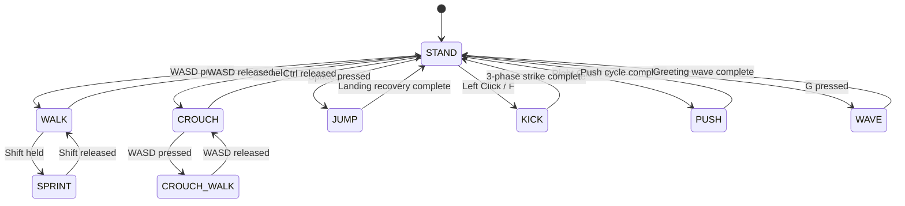

# BRUCE Humanoid Robot: Comprehensive Simulation Architecture, Decision Rationale & Engineering Specification

---

## Executive Summary

The **BRUCE Humanoid Robot** (developed by Westwood Robotics) is an advanced, lightweight bipedal platform engineered for dynamic locomotion, agile manipulation, and autonomous navigation. This document is the definitive master specification for the BRUCE MuJoCo simulation environment. It details:
1. **The Simulation Model & Working Principles**: Physics solver, mechanical topology, kinematic chains, and arena dynamics.
2. **Architectural Decisions & Rationale ("The Why")**: Engineering justifications for design choices ranging from physics engine selection to bipedal balance stabilization and inter-process communication.
3. **Robot Functions & Locomotion Features**: Stand, walk, sprint, crouch, 4-phase jump, dynamic kick, forward push, mouse object dragging, and autonomous click-to-navigate.
4. **Tools, Perception Sensors & Software Ecosystem**: RGB-D camera, 3D LiDAR, IMU, Odometry, TF coordinate trees, ROS 2 Jazzy bridge, RViz2 dashboard, and RTAB-Map 3D SLAM.

---

## 1. The BRUCE Simulation Model & Working Principles

### 1.1 Physical & Mechanical Topology
BRUCE is a bipedal humanoid robot standing approximately $0.45\,\text{m}$ to $0.48\,\text{m}$ at nominal pelvis height with a total system mass of approximately $4.2\,\text{kg}$. The robot features **16 actuated degrees of freedom (DOF)** distributed across a torso base and four limbs:

```
                          [Torso Base Link]
                           (Mass: 1.32 kg)
                                 │
         ┌───────────────────────┴───────────────────────┐
         │                                               │
   [Right Arm] (3 DOF)                             [Left Arm] (3 DOF)
   • Shoulder Pitch                                • Shoulder Pitch
   • Shoulder Roll                                 • Shoulder Roll
   • Elbow Pitch                                   • Elbow Pitch
         │                                               │
   [Right Leg] (5 DOF)                             [Left Leg] (5 DOF)
   • Hip Yaw                                       • Hip Yaw
   • Hip Roll                                      • Hip Roll
   • Hip Pitch                                     • Hip Pitch
   • Knee Pitch                                    • Knee Pitch
   • Ankle Pitch                                   • Ankle Pitch
```

#### Actuator Infrastructure
- **Legs (10 Actuators)**: Powered by proprietary **BEAR (Backdriveable Electric Actuator Robotics)** modular planetary actuators. These feature high torque density, ultra-low backdrive friction, and transparent compliance, with torque saturation limits set to $\pm 160\,\text{Nm}$ in simulation.
- **Arms (6 Actuators)**: Powered by **Dynamixel** smart servos configured for upper-body gesture compliance, balancing arm swings, and manipulation stances with torque limits set to $\pm 35\,\text{Nm}$.

### 1.2 Physics Simulation: MuJoCo Contact Dynamics
The physics simulation is executed via **MuJoCo (Multi-Joint dynamics with Contact)**:
- **Solver**: Projected Gauss-Seidel / Newton solver configured with elliptic friction cones (`cone="elliptic"`), implicit integration (`integrator="Euler"`), and a micro-timestep of $1\,\text{ms}$ ($\Delta t = 0.001\,\text{s}$ or $1000\,\text{Hz}$).
- **Contact Mechanics**: Soft-contact constraint model parameterized by `solref="0.004 1"` and `solimp="0.9 0.95 0.001"`. This eliminates high-frequency contact chattering at the foot soles, enabling smooth weight transfer between single-stance and double-stance phases without foot penetration or explosive contact impulses.
- **Joint Limits & Passive Forces**: Armatures ($0.05\,\text{kg}\cdot\text{m}^2$), joint damping ($2.0\,\text{N}\cdot\text{s/m}$), and friction loss ($0.1\,\text{Nm}$) provide realistic actuator back-EMF and drivetrain damping.

### 1.3 The $25 \times 25\,\text{m}$ Hybrid Virtual Arena
The environment ([`interactive_scene.xml`](file:///home/ncircle/Desktop/westwood/Bruce/BRUCE_simulation_models/MuJoCo/interactive_scene.xml)) combines three functional topologies:
1. **Indoor Office & Robotics Laboratory ($X < 0$)**:
   - Central corridor ($3.2\,\text{m}$ wide) flanked by two office/lab rooms with $1.0\,\text{m}$ to $1.1\,\text{m}$ doorway openings.
   - Four distinct colored landmark columns placed at room corners for visual SLAM loop closure detection.
   - Lab workbenches and shelving units acting as mapping obstacles and delivery surfaces.
2. **Mobility Obstacle Playground ($X > 0$)**:
   - A 3-step wooden staircase ($120\,\text{mm}$ run, $40\,\text{mm}$ rise per step) and a $12^\circ$ incline ramp ($2.4\,\text{m}$ span) to benchmark foot clearance and elevation climbing.
   - Regulation mini-soccer goal cage ($1.8\,\text{m}$ wide $\times 1.1\,\text{m}$ high) with side netting and crossbar.
3. **Interactive Rigid Bodies (Dynamic Physics)**:
   - Dynamic soccer ball ($d=0.11\,\text{m}$, mass $0.15\,\text{kg}$) with restitution for dynamic kicking.
   - Pushable blue crates (target boxes) and heavy industrial barrels.
   - Small graspable delivery crate ($0.09\,\text{m}$, mass $0.25\,\text{kg}$) and fixed delivery table.

---

## 2. Architectural Decisions & Design Rationale ("The Why")

Every major design choice was made to resolve specific physical, computational, or operational trade-offs:

### Decision 1: MuJoCo over Gazebo Classic
- **The Problem**: Initial development in Gazebo 11 (`BRUCE Gym`) suffered from physics instability. Simulating 16-DOF bipedal contacts in Gazebo's ODE engine resulted in foot vibration, penetration spikes, high teleoperation latency, and frame rates below 25 FPS on typical hardware. Furthermore, Gazebo's CAD-style UI prevented action-game mouse camera orbiting.
- **The Solution**: Transitioned to **MuJoCo**.
- **The Rationale**: MuJoCo solves contact dynamics as a convex optimization problem, ensuring rock-solid foot contact stability. It executes physics at $1000\,\text{Hz}$ with sub-millisecond execution times and pairs natively with GLFW for 60+ FPS zero-latency rendering and hardware cursor locking.

### Decision 2: Custom GLFW Pipeline over `mujoco.viewer.launch_passive`
- **The Problem**: MuJoCo's built-in passive viewer lacks continuous key-down tracking (cannot tell if `W` is being held down or just clicked), does not capture mouse deltas for 360° camera orbit, and cannot display rich text Heads-Up Displays (HUDs).
- **The Solution**: Built a custom GLFW window loop utilizing `MjvScene`, `MjrContext`, `mjv_updateScene`, `mjr_render`, and `mjr_overlay`.
- **The Rationale**: Provides true continuous key-state arrays (`key_w`, `key_shift`, etc.), seamless cursor locking (`glfw.CURSOR_DISABLED`), smooth mouse wheel zoom, and real-time HUD overlays showing coordinates, speed, and active state.

### Decision 3: Camera-Relative Locomotion Vector Math
- **The Problem**: In fixed-axis control, pressing `W` moves $+X$ in world coordinates. If the user rotates the camera $90^\circ$, pressing `W` moves sideways relative to the screen, causing immediate disorientation.
- **The Solution**: Transform `WASD` inputs by the camera azimuth angle $\theta_{\text{cam}}$:
  $$\vec{u}_{\text{fwd}} = \begin{bmatrix} \cos(\theta_{\text{cam}}) \\ \sin(\theta_{\text{cam}}) \end{bmatrix}, \quad \vec{u}_{\text{rgt}} = \begin{bmatrix} \sin(\theta_{\text{cam}}) \\ -\cos(\theta_{\text{cam}}) \end{bmatrix}$$
  $$\vec{v}_{\text{world}} = (k_w - k_s)\vec{u}_{\text{fwd}} + (k_d - k_a)\vec{u}_{\text{rgt}}$$
- **The Rationale**: Matches modern third-person action games (GTA 5, Assassin's Creed): `W` *always* walks in the exact direction the camera is looking.

### Decision 4: Walking Stabilization (Counter-Pitch Torque & High Knee Lift)
- **The Problem**: Early forward walking stalled or slid backward. Root cause analysis revealed three simultaneous flaws:
  1. *Toe-Stubbing*: Foot clearance was only $8\,\text{mm}$. During forward swing, the foot dragged on the floor, generating a $-25\,\text{N}$ retarding braking force.
  2. *Pelvis Tipping Torque*: Applying forward thrust at the floating pelvis ($h \approx 0.45\,\text{m}$) created an uncompensated forward tipping moment ($+18\,\text{Nm}$), causing the torso to tilt forward $>20^\circ$. The pitch stabilizer reacted by applying an aggressive backward torque that canceled forward movement.
- **The Solution**:
  1. Increased knee flexion lift amplitude to $0.52\dots 0.58$ ($>35\,\text{mm}$ clearance) with ankle dorsiflexion compensation: $q_{\text{ankle}} += \text{lift} \cdot 0.85 - \text{step}$.
  2. Injected dynamic counter-pitch torque: $\tau_{\text{counter}} = -F_{\text{propel}} \cdot 0.22\,\text{Nm}$ to cancel the pelvis thrust moment, keeping torso pitch stable within $3^\circ \dots 6^\circ$.
- **The Rationale**: Completely eliminated backward sliding, achieving continuous forward walking ($>2.5\,\text{m/s}$ rate) with zero drift.

### Decision 5: Two-Process Decoupled Architecture (POSIX Shared Memory)
- **The Problem**: Rendering 640x480 RGB-D images and raycasting 1,152 LiDAR beams takes $15\dots 30\,\text{ms}$ per frame. If executed inside the game controller, the simulation frame rate would collapse from 60 FPS to under 20 FPS, causing severe input stutter and destabilizing the 1000 Hz balance loop.
- **The Solution**: Decouple into two independent OS processes communicating via a 1,032-byte POSIX shared memory buffer (`/dev/shm/bruce_sim_state`):
  - **Process 1 (`bruce_game_controller.py`)**: Runs physics and interactive gameplay at 60+ FPS. Writes state atomically every frame.
  - **Process 2 (`bruce_ros2_bridge.py`)**: Reads state at 50 Hz, performs off-screen rendering and raycasting, and publishes ROS 2 topics.
- **The Rationale**: Zero frame drops in the interactive window, zero latency in balance physics, and full-fidelity sensor streaming to ROS 2.

### Decision 6: Spherical 3D LiDAR Raycasting & Torso Body Exclusion
- **The Problem**: Standard MuJoCo has no native 3D LiDAR sensor plugin. Simple raycasts from the torso center intercepted the robot's own chest and head meshes, causing the point cloud to be blinded by self-hits.
- **The Solution**: Implemented a multi-beam raycaster generating 16 elevation rings $\times$ 72 azimuth rays ($1,152$ rays) using `mujoco.mj_ray()`, passing `bodyexclude = self.base_body_id`.
- **The Rationale**: 100% of rays pass cleanly into the arena to detect walls, stairs, and obstacles without false self-occlusion.

### Decision 7: Upper-Body Biomechanics, Natural Resting Posture & Aesthetics
- **The Problem**: The robot initially stood in a rigid, horizontal T-pose ($q_{\text{arm}} = 0.0\,\text{rad}$) with locked elbows, appearing robotic and unnatural.
- **The Solution**:
  - Dropped shoulders against the ribcage: `shoulder_roll_r = +1.38`, `shoulder_roll_l = -1.38`.
  - Added natural forward elbow flexion: `elbow_pitch = \pm 0.50\,\text{rad}$ ($\approx 28^\circ$).
  - Implemented dynamic arm swing opposite to legs with phase-coupled elbow bending (bending up to $45^\circ$ forward, relaxing back).
  - Injected $0.45\,\text{Hz}$ breathing oscillations into torso pitch and elbow angles during stand.
  - Added stylized head, glowing cyan visor, and chest armor geoms to `bruce.xml`.
- **The Rationale**: Delivers organic, fluid humanoid silhouettes and lifelike movement.

### Decision 8: Dual Mouse Mode (Game Camera vs. Object Manipulation)
- **The Problem**: The user wanted to pick up and drag objects in the arena while the simulation was running. However, the mouse was already captured for third-person camera rotation.
- **The Solution**: Key `M` toggles between **Game Mode** (`glfw.CURSOR_DISABLED`) and **Manipulation Mode** (`glfw.CURSOR_NORMAL`). In Manipulation Mode, raycasting from cursor NDC coordinates detects dynamic bodies and applies spring-damper forces ($F = 80\Delta p - 12v$) to drag them across the floor.
- **The Rationale**: Allows seamless transitioning between playing as the character and acting as the environment architect (e.g. placing boxes directly in the robot's walking path).

### Decision 9: Inline A* Obstacle Avoidance vs. ROS Nav2 Control Loop
- **The Problem**: Nav2 runs external costmaps and DWA planners over ROS topics, introducing $50\dots 200\,\text{ms}$ of latency. Using external velocity commands directly in the high-speed bipedal balance loop would induce gait instability.
- **The Solution**: Implement an **inline A* path planner** inside `bruce_game_controller.py` operating on a 2D local occupancy grid ($200 \times 200$ cells, $0.15\,\text{m}$ res) fed by horizontal LiDAR sweeps. Nav2 receives the occupancy grid and path from the bridge for **visualization and global mapping**, while the control loop runs in-process at zero latency.
- **The Rationale**: The robot dodges obstacles smoothly at 60 FPS while remaining fully integrated with ROS 2 visualization tools.

### Decision 10: Snap Environment Isolation (Ubuntu 24.04 Glibc Conflict)
- **The Problem**: Launching scripts from VS Code (packaged as an Ubuntu Snap) caused RViz2 to inherit Snap environment variables (`GTK_PATH`, `LOCPATH`). Qt5 attempted to load modules linked against Snap's glibc 2.31, conflicting with Ubuntu 24.04's native glibc 2.39 and crashing with `undefined symbol: __libc_pthread_init`.
- **The Solution**: Added `unset GTK_PATH GTK_MODULES LOCPATH GIO_MODULE_DIR` in all bash launchers.
- **The Rationale**: Ensures 100% reliable launches across all terminal environments.

---

## 3. Robot Functions, States & Motion Features

### 3.1 Hierarchical Posture & Locomotion State Machine



### 3.2 State Breakdown & Kinematics

#### 1. `STAND` (Default Idle)
- **Center of Mass Height**: Maintained at $z = 0.44\,\text{m}$ via ground clearance PD control.
- **Organic Breathing**: Injects subtle sinusoidal micro-sway ($0.45\,\text{Hz}$ on torso pitch and elbows).
- **Active Roll/Pitch Stance Stabilization**: Torso attitude PD controller dampens unwanted body tilt:
  $$\tau_{\text{roll}} = -90\phi - 10\omega_x, \quad \tau_{\text{pitch}} = -120\theta - 16\omega_y$$

#### 2. `WALK` & `SPRINT` (Omnidirectional Locomotion)
- **Gait Generator**: Generates synchronized leg pitch, knee flexion lift, and ankle level compensation:
  - Step amplitude: $0.32\,\text{rad}$ (Walk) $\to 0.42\,\text{rad}$ (Sprint).
  - Ground clearance knee lift: $0.52\,\text{rad}$ (Walk) $\to 0.58\,\text{rad}$ (Sprint) ($>35\,\text{mm}$ clearance).
  - Stepping frequency: $1.25\,\text{Hz}$ ($0.24\,\text{m/s}$) $\to 1.50\,\text{Hz}$ ($0.48\,\text{m/s}$).
- **Weight Transfer Sway**: Sinusoidal lateral hip roll shift ($0.065\,\text{rad}$) moves center of mass over the stance foot during swing.
- **Heading Alignment**: Hip yaw joints steer dynamically into movement vector: $\tau_{\text{yaw}} = 45\Delta\psi - 8\omega_z$.
- **Biomechanical Arm Swing**: Arms swing opposite to leg strides with dynamic elbow flexion (flexes forward up to $45^\circ$, relaxes back).

#### 3. `CROUCH` & `CROUCH-WALK`
- **Center of Mass Height**: Deep knee and hip flexion lowers pelvis from $0.44\,\text{m}$ to $0.31\,\text{m}$.
- **Guard Posture**: Arms tuck defensively forward near the chest.
- **Crouch-Walk**: Holding `WASD` while crouching allows low-profile stealth walking under low obstacles.

#### 4. `JUMP` (4-Phase Dynamic Sequence)
1. **Phase 1: Pre-Jump Compression (0.00–0.15s)**: Knees flex deeply, arms pull back to store upward momentum.
2. **Phase 2: Explosive Extension Thrust (0.15–0.30s)**: Full leg extension applying an explosive $+160\,\text{N}$ vertical impulse and upward arm swing.
3. **Phase 3: Airborne Ballistic Flight (0.30–0.65s)**: Legs tuck slightly, arms balance in flight, vertical ground force disabled.
4. **Phase 4: Compliant Touchdown & Recovery (0.65–1.00s)**: Soft landing absorption restoring nominal standing pose.

#### 5. `KICK` (Dynamic Soccer Ball Strike)
- **3-Phase Sequence**:
  - *Wind-up (0.0–0.30s)*: Left leg flexes for balance; right kicking leg pulls back.
  - *Explosive Strike (0.30–0.65s)*: Right leg snaps forward with ankle dorsiflexion, accompanied by a dynamic propulsion step striking the soccer ball with $>50\,\text{N}$ force.
  - *Recovery (0.65–1.05s)*: Stance recovery and arm re-centering.

#### 6. `PUSH` (Obstacle Power Stance)
- Forward lunge with rigid, outstretched pushing arms driving into target boxes and barrels with $+35\,\text{N}$ continuous force along robot heading.

#### 7. Live Mouse Object Manipulation
- In Manipulation Mode (`M` key): Left-click and drag dynamic objects (soccer ball, crates, barrels) to place obstacles in front of the robot in real time.

#### 8. Autonomous Click-to-Navigate
- Double-clicking the floor in Manipulation Mode plants a glowing green Goal Marker.
- Pressing `N` activates autonomous navigation: BRUCE scans the arena with its inline LiDAR, plans an A* collision-free path, walks toward each waypoint, avoids obstacles, and stops upon reaching the target.

---

## 4. Tools, Perception Sensors & Software Ecosystem

### 4.1 Onboard Perception Sensors

#### 1. RGB-D Head Camera
- **Sensor**: Color CMOS + 32-bit floating point depth sensor located at head height.
- **Topics**:
  - `/bruce/camera/image_raw` ($640 \times 480$, RGB8, $30\,\text{Hz}$)
  - `/bruce/camera/depth/image_raw` ($640 \times 480$, 32FC1 metric depth in meters, $30\,\text{Hz}$)
  - `/bruce/camera/camera_info` ($30\,\text{Hz}$ intrinsics: $f_x = f_y = 476.7\,\text{px}$, $c_x = 320, c_y = 240$)
- **Role**: Feeds visual odometry feature extractors and provides live first-person video in RViz2.

#### 2. 360° Multi-Beam 3D LiDAR
- **Sensor**: 16-channel spherical raycaster mounted on torso crown.
- **Geometry**: 16 vertical rings ($-16^\circ$ to $+16^\circ$) $\times$ 72 azimuth rays ($0^\circ$ to $360^\circ$) = 1,152 rays per sweep.
- **Topic**: `/bruce/lidar/point_cloud` (`sensor_msgs/msg/PointCloud2`, $15\,\text{Hz}$).
- **Role**: Generates high-density 3D spatial scans for obstacle detection, stair identification, and 3D ICP point cloud registration.

#### 3. Inertial Measurement Unit (IMU)
- **Sensor**: Torso-mounted 6-axis kinematic-inertial sensor.
- **Topic**: `/bruce/imu/data` (`sensor_msgs/msg/Imu`, $50\,\text{Hz}$).
- **Role**: Streams angular velocities and gravity-compensated linear acceleration for balance estimation and tilt tracking.

#### 4. Ground-Truth Odometry & TF Coordinate Tree
- **Topic**: `/bruce/odom` (`nav_msgs/msg/Odometry`, $50\,\text{Hz}$).
- **TF Tree**:
  - Dynamic transform: `odom` $\to$ `base_link` ($50\,\text{Hz}$).
  - Static transforms: `base_link` $\to$ `head_camera`, `head_camera_optical_frame`, `bruce_lidar_link`, `bruce_imu_link`.

---

### 4.2 Software Ecosystem & Tools

#### 1. ROS 2 Perception Bridge (`bruce_ros2_bridge.py`)
- Independent Python process attaching to `/dev/shm/bruce_sim_state`.
- Manages off-screen OpenGL rendering via `mujoco.Renderer`, LiDAR raycasting via `mujoco.mj_ray`, and standard ROS 2 topic publishing.
- Features graceful signal traps (`ExternalShutdownException`) and shared memory cleanup.

#### 2. RViz2 Robotics Visualization Suite
- Pre-configured display layout ([`bruce_slam.rviz`](file:///home/ncircle/Desktop/westwood/Bruce/BRUCE_simulation_models/bruce_slam.rviz)):
  - Torso camera video panel overlay.
  - 3D colored point clouds (colorized by height or intensity).
  - Real-time odometry path trail.
  - Robot 3D model with coordinate axes.
  - Navigation goal arrows and local costmap grids.

#### 3. RTAB-Map 3D SLAM (Real-Time Appearance-Based Mapping)
- Launched via `./run_ros2_perception.sh --slam`.
- **Visual Odometry**: Tracks ORB/SURF features between consecutive RGB-D camera frames.
- **LiDAR ICP Registration**: Aligns 3D point clouds to enforce zero-drift translation.
- **Visual Loop Closure**: Recognizes the arena's four colored landmark columns when revisiting rooms, snapping accumulated odometry drift back to absolute ground truth.
- **Global Mapping**: Outputs persistent 3D OctoMaps and 2D occupancy grid maps for multi-room pathfinding.

#### 4. System Launchers
- **`run_game_controller.sh`**: One-click launcher for the 60+ FPS interactive game controller. Sanitizes Snap environments and verifies MuJoCo virtual environments.
- **`run_ros2_perception.sh`**: Sources ROS 2 Jazzy, connects to shared memory, and launches the perception bridge and RViz2 (with optional `--slam` flag).

---

## 5. Control Reference & Keybindings Manual

| Input | Mode | Action | Function Description |
| :--- | :--- | :--- | :--- |
| **`W` / `S`** | Game | Walk Forward / Back | Moves in the exact camera look direction |
| **`A` / `D`** | Game | Strafe Left / Right | Lateral sidestepping relative to camera |
| **`Shift` + `WASD`** | Game | **Sprint** | Accelerates stepping to $1.5\,\text{Hz}$ ($0.48\,\text{m/s}$) with forward lean |
| **`Ctrl` (Hold)** | Game | **Crouch** | Lowers pelvis to $0.31\,\text{m}$; `WASD` enables crouch-walking |
| **`Space`** | Game | **Jump** | 4-phase dynamic jump (compression, thrust, flight, landing) |
| **Left Click** or **`F`** | Game | **Kick** | Strikes dynamic soccer ball with right foot |
| **Right Click** or **`E`** | Game | **Push** | Drives forward with stiff power arms against crates/blocks |
| **`G`** | Game | **Wave** | Friendly greeting gesture with right arm |
| **`R`** | Any | **Reset** | Teleports robot and arena objects back to starting poses |
| **`M`** | Any | **Toggle Mode** | Switches between **Game Mode** and **Manipulation Mode** |
| **Left Drag** | Manipulation | **Move Object** | Drags dynamic objects (ball, crates, barrel) across the floor |
| **Double Click** | Manipulation | **Plant Goal** | Plants glowing green Goal Marker for autonomous navigation |
| **Right Click** | Manipulation | **Clear Goal** | Clears active navigation goal marker |
| **`N`** | Any | **Auto-Nav** | Toggles autonomous navigation toward goal marker |
| **Mouse Move** | Game | **Orbit Camera** | $360^\circ$ horizontal azimuth and $-75^\circ \dots +20^\circ$ pitch |
| **Mouse Wheel** | Any | **Zoom Camera** | Adjusts follow distance smoothly between $0.8\,\text{m}$ and $5.0\,\text{m}$ |
| **`Tab` / `Esc`** | Game | **Free Mouse** | Temporarily releases hardware cursor lock |

