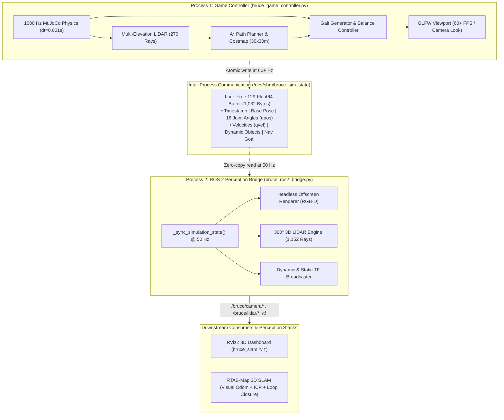

# 🤖 BRUCE Humanoid Robot: Advanced Simulation & Perception Platform

[](#)
[-blue)](#)
[](#)
[](#)
[](#)
[](#)
[](#)

A high-performance, real-time simulation and autonomous robotics ecosystem for the **BRUCE Humanoid Robot** (developed by Westwood Robotics). Features a **GTA-style third-person character controller (60+ FPS)**, **live mouse physics manipulation**, **real-time LiDAR-based A* obstacle avoidance**, a **decoupled ROS 2 Jazzy perception bridge**, and **RTAB-Map 3D SLAM** integration.

---

## 📑 Table of Contents

- [Overview](#-overview)
- [Key Features](#-key-features)
- [System Architecture](#-system-architecture)
- [Tech Stack & Versions](#-tech-stack--versions)
- [Interactive Controls Manual](#-interactive-controls-manual)
- [Installation & Prerequisites](#-installation--prerequisites)
- [Quick Start Guide](#-quick-start-guide)
- [ROS 2 Topic Catalog](#-ros-2-topic-catalog)
- [Repository Structure](#-repository-structure)
- [Troubleshooting & FAQs](#-troubleshooting--faqs)
- [Documentation Index](#-documentation-index)

---

## 🌟 Overview

The **BRUCE Humanoid Robot** is a lightweight, agile bipedal platform ($0.45\,\text{m}$ height, $4.2\,\text{kg}$ mass, 16 actuated DOF) driven by high-density proprietary **BEAR modular planetary actuators** and Dynamixel smart servos.

This repository provides an end-to-end simulation environment operating on a **decoupled two-process architecture**:
1. **Interactive Simulation (Process 1)**: Runs MuJoCo contact physics at **1000 Hz** and a third-person GLFW viewport at **60+ FPS** with zero teleoperation latency.
2. **Perception Bridge (Process 2)**: Streams RGB-D imagery, 1,152-ray 3D LiDAR point clouds, IMU data, and odometry via **ROS 2 Jazzy** to RViz2 and RTAB-Map SLAM through zero-copy **POSIX Shared Memory**.

---

## 🚀 Key Features

* **🎮 Video-Game Style Third-Person Controller**:
  - $360^\circ$ mouse-orbiting follow camera with hardware cursor locking (`glfw.CURSOR_DISABLED`) and mouse wheel zoom.
  - Camera-relative omnidirectional locomotion (`WASD`), dynamic heading alignment, and sprint acceleration (`Left Shift`).
* **🤸 Biomechanical Kinematics & Stability**:
  - Eliminates the rigid T-pose with relaxed human resting postures ($\sim 28^\circ$ forward elbow flexion, arms resting naturally along ribs).
  - Dynamic arm swing counterbalancing leg strides with phase-coupled elbow bending.
  - Zero backward drift: $>35\,\text{mm}$ knee lift and dynamic counter-pitch moment compensation ($\tau = -F_{\text{propel}} \cdot 0.22\,\text{Nm}$).
  - Multi-state postures: Active balance `STAND`, `WALK`, `SPRINT`, `CROUCH`, `CROUCH-WALK`, and 4-phase dynamic `JUMP`.
* **🏢 Simplified, Lightweight Real-World Office Environment**:
  - **Clean $14 \times 14\,\text{m}$ Arena**: High-contrast neutral floor with boundary perimeter walls and balanced lighting for maximum clarity and client demonstrations.
  - **Authentic Furniture Obstacles**: Office desks with wooden tops on 4 cylindrical legs, conference tables, and chairs with blue cushioned seats and backrests, sized proportionally to the $0.45\,\text{m}$ humanoid robot.
  - **Flawless Obstacle Avoidance**: Multi-elevation 3D LiDAR ($Z=0.05\,\text{m}, 0.16\,\text{m}, 0.35\,\text{m}$) scans table legs, chair legs, and seats; inline A* planner routes smooth detour paths with $>1.0\,\text{m}$ clearance.
  - **Ultra-Lightweight Performance**: Only 29 bodies and 79 geoms, ensuring instant loading and guaranteed rock-solid 60+ FPS rendering.
* **⚽ Dynamic Physical Interactions**:
  - **Soccer Kick**: 3-phase leg swing with stance balance, launching dynamic balls with $>50\,\text{N}$ force.
  - **Obstacle Push**: Power forward stance driving against crates and industrial barrels.
  - **Gesture**: Friendly arm wave greeting.
* **🖱️ Live Environment Manipulation & Movable Obstacles**:
  - Press `M` to toggle Manipulation Mode. Left-click and drag dynamic objects (office chairs, delivery crates, soccer ball) across the arena floor in real time.
  - **Live Dynamic Obstacle Testing**: Drag any office chair directly into BRUCE's path while the robot is navigating; BRUCE's real-time LiDAR will instantly detect the new obstacle and calculate an evasive detour path around it on the fly!
* **🧭 Autonomous Navigation & Obstacle Avoidance**:
  - Double-click the floor to plant a glowing green **Goal Marker**.
  - Multi-elevation 3D LiDAR (270 rays across 3 vertical heights: $0.05\,\text{m}$, $0.16\,\text{m}$, $0.35\,\text{m}$) with full-skeleton self-hit filtering.
  - Generates a fixed $30 \times 30\,\text{m}$ world occupancy grid ($0.10\,\text{m}$ resolution) with $0.40\,\text{m}$ obstacle inflation.
  - Inline A* path planner with pure-pursuit lookahead tracking ($0.45\,\text{m}$) and heading-aligned speed modulation.
  - Live cyan path breadcrumb visualization in the 3D viewport.
* **📡 Complete ROS 2 Sensor Suite**:
  - Torso RGB-D Camera ($640 \times 480$ RGB8 + 32-bit float metric depth).
  - $360^\circ$ 16-channel 3D LiDAR ($1,152$ rays via `mj_ray` with body exclusion).
  - 6-DOF IMU, Odometry, and standard TF coordinate tree.
  - Pre-configured RViz2 layout and one-click RTAB-Map 3D SLAM.

---

## 🏗️ System Architecture

Data is transferred between the game loop and perception bridge using an ultra-low-latency 1,032-byte POSIX shared memory buffer:



---

## 💻 Tech Stack & Versions

| Component | Technology | Version | Purpose |
| :--- | :--- | :--- | :--- |
| **Physics Engine** | **MuJoCo** | `3.16.0` | 1000 Hz contact dynamics, soft contacts, joint limits |
| **Language Runtime** | **Python** | `3.12.3` | Core character controller, A* planner & bridge node |
| **Window & Graphics** | **GLFW / OpenGL** | `2.10.2 / 3.3+` | 60+ FPS 3D window, mouse lock & HUD overlays |
| **Robotics Middleware** | **ROS 2** | `Jazzy Jalisco` | Topic serialization, QoS sensor streaming, TF tree |
| **Robotics Dashboard** | **RViz2** | `14.1.24` | 3D visualizer for point clouds, images & odometry |
| **SLAM Pipeline** | **RTAB-Map** | `0.21.x` | 3D Visual Odometry, LiDAR ICP alignment & mapping |
| **Scientific Computing** | **NumPy / SciPy** | `2.5.4 / 1.18.1` | Vector linear algebra & obstacle costmap dilation |
| **Path Planning** | **A\* Algorithm** | `Python StdLib` | Optimal grid search using `heapq` priority queue |
| **IPC Layer** | **POSIX Shared Memory** | `POSIX.1-2001` | Zero-copy state streaming via `/dev/shm` buffer |
| **Robot Modeling** | **MJCF / STL** | `MuJoCo 3.x` | Kinematic XML definitions and high-res CAD meshes |
| **Host Operating System**| **Ubuntu Linux** | `24.04.5 LTS` | Linux Kernel 7.0 generic execution environment |

---

## 🎮 Interactive Controls Manual

### Locomotion & Character Posture
| Key / Input | Mode | Action | Description |
| :--- | :---: | :--- | :--- |
| **`W` / `S`** | Game | **Walk Forward / Back** | Camera-relative movement in active look direction |
| **`A` / `D`** | Game | **Strafe Left / Right** | Lateral stepping relative to camera viewport |
| **`Left Shift`** | Game | **Sprint** | Accelerates gait to $1.5\,\text{Hz}$ ($0.48\,\text{m/s}$) with forward lean |
| **`Left Ctrl`** | Game | **Crouch** | Drops pelvis to $0.31\,\text{m}$; `WASD` enables crouch-walking |
| **`Space`** | Game | **Dynamic Jump** | 4-phase jump (compression dip $\to$ $+160\,\text{N}$ thrust $\to$ flight $\to$ landing) |
| **Left Click / `F`**| Game | **Kick Ball** | Dynamic 3-phase strike kicking the soccer ball forward |
| **Right Click / `E`**| Game | **Push Stance** | Rigid forward power drive against boxes and barrels |
| **`G`** | Game | **Arm Wave** | Friendly greeting gesture with right arm |
| **`R`** | Any | **Reset Scene** | Resets robot pose, soccer ball, and arena obstacles |

### Camera & Viewport
| Key / Input | Action | Description |
| :--- | :--- | :--- |
| **Mouse Move** | **Orbit Camera** | $360^\circ$ horizontal azimuth and $-75^\circ \dots +20^\circ$ vertical pitch |
| **Mouse Wheel** | **Zoom Distance** | Adjusts third-person follow distance between $0.8\,\text{m}$ and $5.0\,\text{m}$ |
| **`Tab` / `Esc`** | **Cursor Unlock** | Temporarily releases hardware cursor lock to click outside window |

### Object Manipulation & Autonomous Navigation
| Key / Input | Mode | Action | Description |
| :--- | :---: | :--- | :--- |
| **`M`** | Any | **Toggle Mode** | Switches between **Game Mode** (camera look) and **Manipulation Mode** |
| **Left Drag** | Manipulation | **Move Object** | Drags dynamic objects (ball, crates, barrel) across the floor live |
| **Double Click**| Manipulation | **Plant Goal** | Plants glowing green Goal Marker on floor for autonomous navigation |
| **Right Click** | Manipulation | **Clear Goal** | Cancels and removes the active navigation goal marker |
| **`N`** | Any | **Auto-Nav** | Toggles autonomous navigation (robot follows cyan path avoiding obstacles) |

---

## 📦 Installation & Prerequisites

### 1. System Requirements
- **OS**: Ubuntu 24.04 LTS (Noble Numbat)
- **ROS 2**: ROS 2 Jazzy Jalisco (Desktop Install)
- **Python**: Python 3.12+ with virtual environment support

### 2. Install ROS 2 Jazzy & Core Packages
```bash
sudo apt update && sudo apt install -y \
  ros-jazzy-desktop \
  ros-jazzy-rviz2 \
  ros-jazzy-tf2-ros \
  ros-jazzy-sensor-msgs-py \
  ros-jazzy-rtabmap-ros
```

### 3. Python Virtual Environment Setup
Ensure your virtual environment contains `mujoco`, `glfw`, `numpy`, and `scipy`:
```bash
# Example creating and activating a virtual environment
python3 -m venv ~/bruce_env
source ~/bruce_env/bin/activate
pip install mujoco glfw numpy scipy
```

---

## 🚦 Quick Start Guide

Open two terminal windows to run the decoupled simulation and perception bridge:

### Step 1: Launch Interactive Game Controller (Window 1)
In your primary terminal:
```bash
cd /home/ncircle/Desktop/westwood/Bruce/BRUCE_simulation_models
./run_game_controller.sh
```
* **Interact**: Use `WASD` to walk, mouse to look around, and `Shift` to sprint.
* **Manipulate**: Press `M`, drag a crate into the robot's runway, double-click the floor to plant a green Goal Marker, then press `N` to watch BRUCE autonomously dodge obstacles!

### Step 2: Launch ROS 2 Perception Bridge & RViz2 (Window 2)
In a second terminal:
```bash
cd /home/ncircle/Desktop/westwood/Bruce/BRUCE_simulation_models
./run_ros2_perception.sh
```
* Launches the headless perception node and opens **RViz2** configured with 3D LiDAR point clouds, first-person camera overlay, odometry path trails, and TF frames.

### Step 3 (Optional): Launch with RTAB-Map 3D SLAM
To build persistent 3D point cloud maps and 2D occupancy grids while walking:
```bash
cd /home/ncircle/Desktop/westwood/Bruce/BRUCE_simulation_models
./run_ros2_perception.sh --slam
```

---

## 📡 ROS 2 Topic Catalog

When the perception bridge is active, the following topics are published:

| Topic Name | Message Type | Rate | Description |
| :--- | :--- | :---: | :--- |
| `/bruce/camera/image_raw` | `sensor_msgs/msg/Image` | $30\,\text{Hz}$ | $640 \times 480$ 24-bit RGB8 head camera video |
| `/bruce/camera/depth/image_raw` | `sensor_msgs/msg/Image` | $30\,\text{Hz}$ | $640 \times 480$ 32-bit floating-point metric depth |
| `/bruce/camera/camera_info` | `sensor_msgs/msg/CameraInfo` | $30\,\text{Hz}$ | Calibrated camera intrinsic projection matrix |
| `/bruce/lidar/point_cloud` | `sensor_msgs/msg/PointCloud2` | $15\,\text{Hz}$ | $360^\circ$ 3D LiDAR scan ($1,152$ rays, 16 rings) |
| `/bruce/imu/data` | `sensor_msgs/msg/Imu` | $50\,\text{Hz}$ | Torso linear acceleration and angular velocity |
| `/bruce/odom` | `nav_msgs/msg/Odometry` | $50\,\text{Hz}$ | Robot ground-truth 6-DOF pose and twist |
| `/tf` & `/tf_static` | `tf2_msgs/msg/TFMessage` | $50\,\text{Hz}$ | Coordinate tree (`odom` $\to$ `base_link` $\to$ camera/lidar/imu) |
| `/bruce/nav/goal` | `geometry_msgs/msg/PoseStamped` | $5\,\text{Hz}$ | Active navigation target marker position |
| `/bruce/nav/path` | `nav_msgs/msg/Path` | $5\,\text{Hz}$ | Visualization path trail from robot to goal |
| `/bruce/nav/occupancy` | `nav_msgs/msg/OccupancyGrid` | $2\,\text{Hz}$ | $100 \times 100$ local 2D occupancy grid ($0.15\,\text{m}$ res) |

---

## 📁 Repository Structure

```
BRUCE_simulation_models/
├── README.md                           # Main Project Documentation (This File)
├── BRUCE_MASTER_SPECIFICATION.md       # Complete Master Engineering Specification
├── BRUCE_MASTER_SPECIFICATION.docx     # Formatted Word Document with Architecture Figures
├── BRUCE_MASTER_SPECIFICATION.pdf      # Print-Ready High-Res PDF Specification
├── sensors_dataflow.md                 # Complete Sensor Pipeline & Dataflow Reference
├── sensors_dataflow.docx               # Word Document for Sensor Pipeline
├── sensors_dataflow.pdf                # PDF Document for Sensor Pipeline
├── decision.md                         # Formal Architectural Decisions Log (Decisions 1-20)
├── changes.md                          # Comprehensive Development Changelog
├── workflow.md                         # Step-by-Step Operator Guide & Troubleshooting
├── ai.md                               # AI Persistent Context & System Memory
├── docs_assets/                        # High-resolution 300 DPI architecture diagrams
│   ├── pipeline.png                    # End-to-End System Pipeline Diagram
│   ├── state_machine.png               # Locomotion Finite State Machine Diagram
│   └── tf_tree.png                     # Spatial Coordinate Transform Tree Diagram
│
├── run_game_controller.sh              # One-Click Launcher for Interactive Controller
├── run_ros2_perception.sh              # One-Click Launcher for ROS 2 Bridge + RViz2
├── bruce_slam.rviz                     # Pre-Configured RViz2 Perception Layout
│
├── MuJoCo/
│   ├── bruce.xml                       # Robot MJCF Model (Kinematics, BEARs, Sensors)
│   ├── interactive_scene.xml           # 25x25m Hybrid Arena (Corridors, Obstacles, Props)
│   ├── bruce_game_controller.py        # 60+ FPS GTA Character Controller & A* Nav
│   └── bruce_ros2_bridge.py            # ROS 2 Jazzy Zero-Copy Sensor Bridge Node
│
└── Gazebo/                             # Original CAD Meshes & URDFs
    └── meshes/                         # High-Precision STL Link Geometry Files
```

---

## 🔧 Troubleshooting & FAQs

### Q1: RViz2 crashes with `symbol lookup error: libpthread.so.0: undefined symbol: __libc_pthread_init`
* **Cause**: When running inside VS Code (packaged as an Ubuntu Snap), Snap environment variables (`GTK_PATH`, `LOCPATH`) leak into the terminal, forcing Qt5 to link against core20's older glibc 2.31 instead of Ubuntu 24.04's glibc 2.39.
* **Fix**: The launchers handle this automatically. If running manually, execute:
  ```bash
  unset GTK_PATH GTK_MODULES LOCPATH GIO_MODULE_DIR
  ```

### Q2: Bridge node displays `Shared memory 'bruce_sim_state' not found`
* **Cause**: Window 2 was launched before Window 1.
* **Fix**: Always start `./run_game_controller.sh` first so the shared memory buffer is initialized, then launch `./run_ros2_perception.sh`.

### Q3: How do I clean up stale shared memory after an abrupt exit?
* **Fix**: Run the cleanup one-liner:
  ```bash
  python3 -c "from multiprocessing import shared_memory; m = shared_memory.SharedMemory('bruce_sim_state'); m.close(); m.unlink()"
  ```

### Q4: Mouse cursor is locked and I cannot click outside the window
* **Fix**: Press **`Tab`** or **`Esc`** to release the mouse cursor. Click back inside the window to re-lock.

---

## 📚 Documentation Index

For in-depth mathematical formulations, code architecture, and sensor hardware specs, refer to:
* 📄 [**BRUCE Master Specification (`.md`)**](file:///home/ncircle/Desktop/westwood/Bruce/BRUCE_simulation_models/BRUCE_MASTER_SPECIFICATION.md) | [**PDF**](file:///home/ncircle/Desktop/westwood/Bruce/BRUCE_simulation_models/BRUCE_MASTER_SPECIFICATION.pdf) | [**DOCX**](file:///home/ncircle/Desktop/westwood/Bruce/BRUCE_simulation_models/BRUCE_MASTER_SPECIFICATION.docx)
* 📄 [**Sensor Dataflow & Pipeline Specification (`.md`)**](file:///home/ncircle/Desktop/westwood/Bruce/BRUCE_simulation_models/sensors_dataflow.md) | [**PDF**](file:///home/ncircle/Desktop/westwood/Bruce/BRUCE_simulation_models/sensors_dataflow.pdf) | [**DOCX**](file:///home/ncircle/Desktop/westwood/Bruce/BRUCE_simulation_models/sensors_dataflow.docx)
* 📄 [**Architectural Decisions Log (`decision.md`)**](file:///home/ncircle/Desktop/westwood/Bruce/BRUCE_simulation_models/decision.md)
* 📄 [**Changelog & History (`changes.md`)**](file:///home/ncircle/Desktop/westwood/Bruce/BRUCE_simulation_models/changes.md)
* 📄 [**Workflow & Operator Guide (`workflow.md`)**](file:///home/ncircle/Desktop/westwood/Bruce/BRUCE_simulation_models/workflow.md)

---

## 👥 Acknowledgments & Credits

* **Hardware & Base Model**: Westwood Robotics & Jun Young Kim (김준영).
* **Physics Engine**: MuJoCo by Google DeepMind.
* **Robotics Middleware**: Open Robotics (ROS 2 Jazzy).

