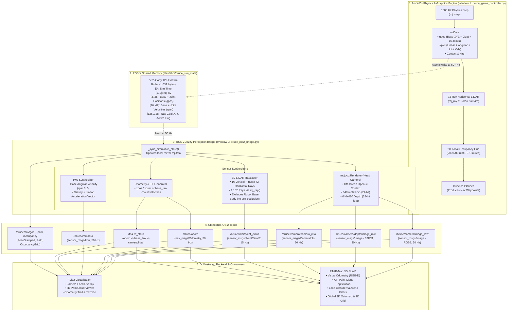

# BRUCE Humanoid Robot: Sensor Architecture, Dataflow & Process Flow

This document provides a comprehensive technical reference for all sensors implemented on the **BRUCE Humanoid Robot** simulation platform. It details the end-to-end dataflow and process flow across all system boundaries—from MuJoCo contact physics and off-screen rendering, through POSIX shared memory inter-process communication (IPC), into the ROS 2 Jazzy perception bridge, and down to consumer nodes (RViz2, RTAB-Map SLAM, and Path Planners).

---

## 1. System Architecture & End-to-End Pipeline

The simulation uses a **two-process decoupled architecture** to ensure contact physics runs at 1000 Hz and the interactive game window runs at 60+ FPS without being throttled by heavy image rendering or raycasting.



---

## 2. Sensor Catalog & Specifications

| Sensor Name | Model / Source | Mounting Frame | Sampling Rate | ROS 2 Topic | ROS 2 Message Type |
| :--- | :--- | :--- | :--- | :--- | :--- |
| **RGB Camera** | Virtual CMOS | `head_camera_optical_frame` | $30\,\text{Hz}$ | `/bruce/camera/image_raw` | `sensor_msgs/msg/Image` (RGB8) |
| **Depth Camera** | Virtual Z-Buffer | `head_camera_optical_frame` | $30\,\text{Hz}$ | `/bruce/camera/depth/image_raw` | `sensor_msgs/msg/Image` (32FC1) |
| **Camera Info** | Pin-hole Matrix | `head_camera_optical_frame` | $30\,\text{Hz}$ | `/bruce/camera/camera_info` | `sensor_msgs/msg/CameraInfo` |
| **3D 16-Beam LiDAR** | Virtual Raycaster | `bruce_lidar_link` | $15\,\text{Hz}$ | `/bruce/lidar/point_cloud` | `sensor_msgs/msg/PointCloud2` |
| **IMU (6-DOF)** | Inertial base | `bruce_imu_link` | $50\,\text{Hz}$ | `/bruce/imu/data` | `sensor_msgs/msg/Imu` |
| **Odometry** | Floating base EKF | `odom` $\to$ `base_link` | $50\,\text{Hz}$ | `/bruce/odom` | `nav_msgs/msg/Odometry` |
| **TF Coordinate Tree** | Kinematic model | Multi-frame | $50\,\text{Hz}$ | `/tf`, `/tf_static` | `tf2_msgs/msg/TFMessage` |
| **Local 2D Nav Grid** | Inline raycaster | `odom` | $2\,\text{Hz}$ | `/bruce/nav/occupancy` | `nav_msgs/msg/OccupancyGrid` |
| **Navigation Goal** | User mouse picker | `odom` | $5\,\text{Hz}$ | `/bruce/nav/goal` | `geometry_msgs/msg/PoseStamped` |

---

## 3. Deep-Dive: Sensor Process & Data Flows

### 3.1 RGB-D Head Camera

#### Physical Model & Placement
The sensor is defined in `bruce.xml` rigidly fixed to the robot torso (`base_link`):
```xml
<camera name="head_camera" pos="0.08 0 0.16" fovy="65" xyaxes="0 -1 0 0 0 1"/>
```
- **Position**: $8\,\text{cm}$ forward, $16\,\text{cm}$ above the torso base origin.
- **Field of View (FOV)**: $65^\circ$ vertical.
- **Orientation**: Standard ROS optical convention (optical $+Z$ axis pointing forward, $+X$ right, $+Y$ down).

#### Dataflow Pipeline
1. **Kinematic Synchronization**:
   - `bruce_ros2_bridge.py` reads `qpos` from shared memory and updates its mirror model: `mujoco.mj_forward(self.model, self.data)`.
2. **Off-screen OpenGL Render**:
   - Uses `mujoco.Renderer(self.model, height=480, width=640)`.
   - `self.renderer.update_scene(self.data, camera="head_camera")`.
3. **RGB Processing**:
   - `rgb_img = self.renderer.render()` yields a contiguous NumPy array of shape $(480, 640, 3)$ with `uint8` values.
   - Serialized to `sensor_msgs/msg/Image`:
     - `encoding = "rgb8"`
     - `step = 640 * 3 = 1920` bytes
     - `data = rgb_img.tobytes()`
4. **Depth Processing**:
   - `self.renderer.enable_depth_rendering()`
   - `depth_img = self.renderer.render()` returns physical metric distance per pixel in meters ($Z$ buffer transformed to linear Euclidean depth).
   - Serialized to `sensor_msgs/msg/Image`:
     - `encoding = "32FC1"`
     - `step = 640 * 4 = 2560` bytes
     - `data = depth_img.astype(np.float32).tobytes()`
5. **Intrinsics Calculation**:
   - Focal length: $f_y = \frac{480}{2 \cdot \tan(65^\circ / 2)} \approx 476.7\,\text{px}$, $f_x = f_y$.
   - Principal point: $c_x = 320.0, c_y = 240.0$.
   - Formatted into the $3 \times 3$ intrinsic matrix $K$ and $3 \times 4$ projection matrix $P$.
6. **Consumer Handling**:
   - **RViz2**: Displays the RGB stream in an image viewport and registers the 32-bit depth map to colorize point clouds.
   - **RTAB-Map**: Extracts visual features (ORB/FAST) from RGB, computes their 3D position using the matching depth pixel, and computes Visual Odometry motion estimates.

---

### 3.2 360° Multi-Beam 3D LiDAR

#### Physical Model & Placement
Defined at `lidar_site` on the crown of the torso:
```xml
<site name="lidar_site" pos="0.02 0 0.22" size="0.035 0.018" type="cylinder"/>
```

#### Beam Geometry
- **Vertical Coverage**: 16 channels spanning from $-16.0^\circ$ to $+16.0^\circ$ ($\approx 2.13^\circ$ vertical angular resolution).
- **Horizontal Coverage**: 72 steps across $360.0^\circ$ ($5.0^\circ$ horizontal angular resolution).
- **Total Beams per Sweep**: $16 \times 72 = 1,152$ rays.

#### Dataflow Pipeline
1. **Ray Unit Vector Table**:
   - Pre-computed in spherical coordinates:
     $$\vec{u}_{\text{local}} = \begin{bmatrix} \cos(\theta_{\text{el}}) \cos(\phi_{\text{az}}) \\ \cos(\theta_{\text{el}}) \sin(\phi_{\text{az}}) \\ \sin(\theta_{\text{el}}) \end{bmatrix}$$
2. **Torso Transform & Self-Occlusion Avoidance**:
   - At each cycle, the local ray vectors are rotated by the site orientation matrix:
     $$\vec{u}_{\text{world}} = R_{\text{lidar}} \cdot \vec{u}_{\text{local}}$$
   - Raycasted into the physical scene using MuJoCo's collision query:
     ```python
     dist = mujoco.mj_ray(self.model, self.data, lidar_pos, vec_world, None, 1, self.base_body_id, geom_id)
     ```
   - **Crucial Feature**: `bodyexclude = self.base_body_id` prevents rays from self-intersecting the robot's head, visor, shoulders, or chest armor plate.
3. **Point Filtering & Formatting**:
   - Valid range: $0.15\,\text{m} < \text{dist} < 25.0\,\text{m}$.
   - Hit points $\vec{p} = \vec{u}_{\text{local}} \cdot \text{dist}$ stored as float32 triples.
   - Serialized into standard binary `sensor_msgs/msg/PointCloud2` using `sensor_msgs_py.point_cloud2.create_cloud_xyz32`.
4. **Consumer Handling**:
   - **RViz2**: Visualized as 3D colored points (colored by height or intensity).
   - **RTAB-Map ICP**: Matches consecutive sweeps via 3D Iterative Closest Point algorithm to provide LiDAR Odometry when camera visual features are sparse.

---

### 3.3 Inertial Measurement Unit (IMU)

#### Physical Origin
Synthesized from the floating base rigid body dynamics of `base_link` inside MuJoCo.

#### Dataflow Pipeline
1. **Orientation**:
   - Extracted directly from `self.data.xquat[base_body_id]` as unit quaternion $(w, x, y, z)$.
2. **Angular Velocity**:
   - Extracted from generalized velocities `self.data.qvel[3:6]` representing body rotational rates $(\omega_x, \omega_y, \omega_z)$ in $\text{rad/s}$.
3. **Linear Acceleration**:
   - Senses both dynamic acceleration and the gravitational reaction force:
     $$\vec{a}_{\text{sensed}} = \vec{a}_{\text{base}} + \begin{bmatrix} 0 \\ 0 \\ 9.81 \end{bmatrix}\,\text{m/s}^2$$
4. **Packaging**:
   - Built into `sensor_msgs/msg/Imu` with timestamp and fixed frame `bruce_imu_link` published at **50 Hz**.
5. **Consumer Handling**:
   - Provides high-frequency orientation feedback for balance control and complements low-frequency visual odometry.

---

### 3.4 Odometry & TF Coordinate Tree

#### Pipeline
1. **Ground-Truth Extraction**:
   - Torso Cartesian coordinates: `self.data.xpos[base_body_id]` $\to (X, Y, Z)$.
   - Torso orientation: `self.data.xquat[base_body_id]` $\to (w, x, y, z)$.
   - Linear and angular velocities: `self.data.qvel[0:6]`.
2. **ROS Message Formatting**:
   - Published as `nav_msgs/msg/Odometry` on `/bruce/odom` at **50 Hz**.
3. **TF Tree Hierarchy**:
   ```
   odom (World Navigation Origin)
     └── base_link (Robot Center of Mass) [50 Hz Dynamic TF]
           ├── head_camera (Torso Camera Mount) [Static TF]
           │     └── head_camera_optical_frame (Standard ROS Optical Frame) [Static TF]
           ├── bruce_lidar_link (3D LiDAR Sensor Center) [Static TF]
           └── bruce_imu_link (IMU Origin) [Static TF]
   ```

---

### 3.5 Proprioceptive Joint Encoders (16 DOF)

#### Actuator Mapping
- **Right Leg (5 DOF)**: `hip_yaw_r`, `hip_roll_r`, `hip_pitch_r`, `knee_pitch_r`, `ankle_pitch_r`
- **Left Leg (5 DOF)**: `hip_yaw_l`, `hip_roll_l`, `hip_pitch_l`, `knee_pitch_l`, `ankle_pitch_l`
- **Right Arm (3 DOF)**: `shoulder_pitch_r`, `shoulder_roll_r`, `elbow_pitch_r`
- **Left Arm (3 DOF)**: `shoulder_pitch_l`, `shoulder_roll_l`, `elbow_pitch_l`

#### Dataflow Pipeline
1. **Control Loop (1000 Hz)**:
   - Current joint positions $q$ and velocities $\dot{q}$ read from `data.qpos` and `data.qvel`.
   - Error calculated against target trajectory: $e = q_{\text{target}} - q$.
   - PD control law computes joint torques:
     $$\tau = K_p (q_{\text{target}} - q) - K_d \dot{q}$$
   - Clamped to actuator saturation limits ($\pm 160\,\text{Nm}$ for BEAR leg actuators, $\pm 35\,\text{Nm}$ for arm servos) and applied via `data.ctrl`.
2. **IPC Forwarding**:
   - Written to POSIX shared memory buffer `bruce_sim_state` every simulation step.
   - Allows Process 2 to duplicate the robot's physical configuration for raycasting without querying Process 1.

---

### 3.6 Inline 2D Navigation LiDAR & Occupancy Grid

#### Purpose
Enables real-time obstacle avoidance and autonomous path planning directly inside `bruce_game_controller.py` at 60+ FPS without introducing ROS network latency into the bipedal balance loop.

#### Dataflow Pipeline
1. **Raycasting**:
   - Every 20 physics steps (~50 Hz), 72 horizontal rays cast from torso height ($Z = 0.4\,\text{m}$) in a full circle.
2. **Decaying Grid Accumulator**:
   - Grid size: $200 \times 200$ cells with $0.15\,\text{m}$ resolution ($30 \times 30\,\text{m}$ total area).
   - Ray intersections increment hit cells by $+80$ (up to 255).
   - All cells decay by $-1$ per cycle, allowing the robot to "forget" cleared paths when dynamic objects (such as soccer balls or boxes) are pushed out of the way.
3. **Obstacle Dilation**:
   - Binary dilation expands occupied cells by 2 grid cells ($0.30\,\text{m}$) to account for BRUCE's physical body radius.
4. **A\* Path Planning**:
   - When the user plants a goal marker, A\* searches the grid from robot $(X, Y)$ to goal $(X, Y)$, generating collision-free waypoints.
5. **Shared Memory Export**:
   - Active goal $(X, Y)$ is written to slots 126–128 of shared memory.
   - `bruce_ros2_bridge.py` reads these slots and publishes standard ROS topics:
     - `/bruce/nav/goal` (`geometry_msgs/PoseStamped`)
     - `/bruce/nav/path` (`nav_msgs/Path`)
     - `/bruce/nav/occupancy` (`nav_msgs/OccupancyGrid`)

---

## 4. POSIX Shared Memory Layout (`bruce_sim_state`)

The inter-process communication bridge uses a dedicated memory segment in `/dev/shm` sized at **129 contiguous double-precision floats (1,032 bytes)**:

```
Index Offset    Data Type    Content Description                          Update Rate
[0]             float64      Simulation Time (seconds)                    1000 Hz
[1]             float64      nq (Model generalized coordinates = 23)      Static
[2]             float64      nv (Model degrees of freedom = 22)           Static
[3 .. 5]        float64[3]   Robot Base Position (X, Y, Z) in meters      1000 Hz
[6 .. 9]        float64[4]   Robot Base Quaternion (w, x, y, z)           1000 Hz
[10 .. 25]      float64[16]  16 Actuated Joint Angles (qpos) in radians   1000 Hz
[26 .. 28]      float64[3]   Base Linear Velocity (vx, vy, vz) in m/s     1000 Hz
[29 .. 31]      float64[3]   Base Angular Velocity (wx, wy, wz) in rad/s  1000 Hz
[32 .. 47]      float64[16]  16 Actuated Joint Velocities (qvel) in rad/s 1000 Hz
[48 .. 125]     float64[78]  Scene Dynamic Bodies (Ball, Boxes, Barrels)  1000 Hz
[126]           float64      Nav Goal X coordinate (meters)               On Change
[127]           float64      Nav Goal Y coordinate (meters)               On Change
[128]           float64      Nav Goal Active Flag (1.0 = On, 0.0 = Off)   On Change
```

---

## 5. Downstream Backend Consumers

### 5.1 RViz2 (Robotics Visualization)
- **Displays Configured**:
  - `RobotModel`: Reconstructs BRUCE's 3D mesh via the TF tree.
  - `PointCloud2`: Renders the 1,152-beam 3D LiDAR point cloud.
  - `Image`: Displays the RGB torso camera feed.
  - `Odometry`: Renders the path trail showing where BRUCE has walked.
  - `Map`: Visualizes both the 2D local occupancy grid and global SLAM maps.
  - `Pose`: Shows active navigation goals as 3D directional arrows.

### 5.2 RTAB-Map SLAM (Real-Time Appearance-Based Mapping)
- **Sensor Inputs**:
  - `/bruce/camera/image_raw` + `/bruce/camera/depth/image_raw` + `/bruce/camera/camera_info`
  - `/bruce/lidar/point_cloud`
  - `/bruce/odom`
- **Output Capabilities**:
  - Computes Visual Odometry using visual features.
  - Performs ICP matching on 3D LiDAR scans.
  - Detects visual loop closures when seeing the arena's 4 landmark columns.
  - Outputs persistent global 3D OctoMaps and 2D occupancy maps for global navigation across multiple rooms.

